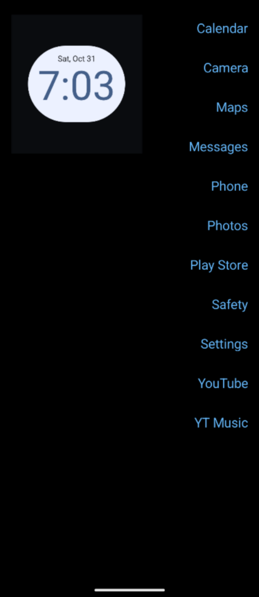
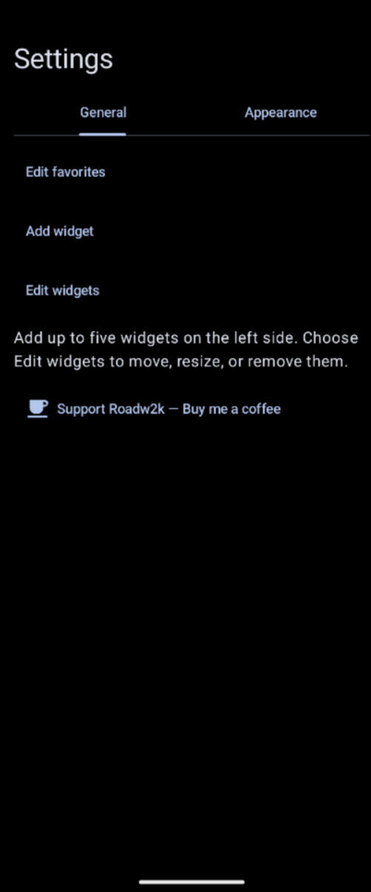
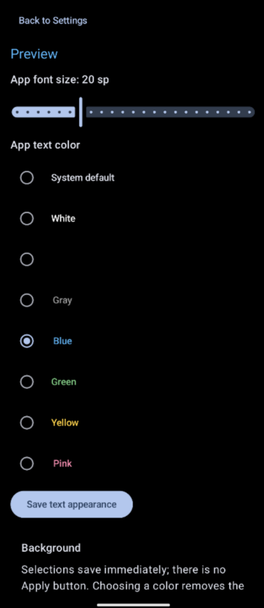

# Minimal Launcher

An Android launcher that keeps things simple: your favorite apps on the right, widgets on the left, and the rest of your apps a swipe away.

App names replace the usual grid of icons. Pick what belongs on your home screen, choose a background, and leave the rest out of the way.

## Screenshots

| Home | Settings | Customization |
| --- | --- | --- |
|  |  |  |

## Using it

On first launch, select your favorite apps and tap **Save**. To make it your home screen, choose **Minimal Launcher** in Android's default home app settings. The exact menu varies by device, but it's usually under **Settings → Apps → Default apps → Home app**.

- **Open an app:** tap its name.
- **Open the app drawer:** swipe from right to left across the home screen.
- **Return home:** swipe from left to right in the drawer, or press Back.
- **Open Settings:** press and hold an empty area of the home screen until the progress ring finishes.

The home screen and drawer follow your finger as you swipe. Android's navigation buttons or gesture handle remain available; gestures starting at the very edge may still be handled by the system.

## Make it yours

### Favorites and text

Use **Edit favorites** in Settings to change the apps shown on the home screen. The drawer keeps the full list of launchable apps sorted alphabetically.

The **Appearance** tab lets you change app-name colors and font size, with a preview before saving. Black text switches to white on a solid black background, and white text switches to black on a solid white background. Your saved color choice isn't overwritten.

### Backgrounds

Choose a solid color, follow the system theme, or use your own picture. Background changes save immediately and apply throughout the launcher, including Settings and the favorites picker.

Pictures are imported through Android's file picker and copied into the app's private storage. The import limit is **25 MB**, and large images are downsampled for display. Choosing a solid color removes the imported picture.

### Widgets

Add up to **five widgets** from Settings. Use **Edit widgets** to move, resize, or remove them. Drag **Move** to reposition a widget and the bottom-right resize control to resize it, where the widget supports resizing.

Android may ask you to approve or configure a widget when adding it. Widgets keep their own styling and update behavior, so the launcher's text-color settings won't change their contents.

## Battery and background work

The launcher doesn't run a background service or hold a wake lock. It caches the app list rather than scanning installed apps every time you return home, and refreshes it when apps or their availability change.

Widget-provider information is cached, unchanged widget dimensions aren't repeatedly reported, and widget listening stops when the launcher activity is no longer visible. Widget providers can still do their own background work independently.

A black background can also reduce display power on OLED screens. That benefit depends on the screen and how long the launcher is visible; it isn't a measured battery-life claim.

## Build

The app is written in **Kotlin**, using **Jetpack Compose** and **Material 3**.

- **Minimum Android version:** Android 12 / API 31
- **Compile and target SDK:** API 37
- **Gradle:** use the included wrapper
- **Gradle daemon JDK:** Java 25, configured in `gradle/gradle-daemon-jvm.properties`

Open the project in an Android Studio version compatible with the Android Gradle Plugin declared in `gradle/libs.versions.toml`. Install the required SDK when prompted and let Gradle sync. The build uses toolchain provisioning for the daemon JDK, so the first sync may need to download it.

From the project root:

```sh
./gradlew assembleDebug
```

The debug APK is written to:

```text
app/build/outputs/apk/debug/app-debug.apk
```

With a device or emulator connected:

```sh
./gradlew installDebug
```

On Windows, use `gradlew.bat` instead of `./gradlew`. For command-line builds, make sure the Android SDK is configured through `local.properties` (`sdk.dir`) or your environment. Keep machine-specific SDK paths out of version control.

### Checks

```sh
./gradlew :app:testDebugUnitTest :app:lintDebug
```

To run the instrumented tests, connect a device or start an emulator first:

```sh
./gradlew :app:connectedDebugAndroidTest
```

The current tests don't replace checking gestures, widget behavior, and icon rendering on a device.

## Where things live

Source files are under `app/src/main/java/com/roadw2k/minimallauncher/`:

| File | Purpose |
| --- | --- |
| `MainActivity.kt` | Home screen, favorites, settings, app discovery, and navigation |
| `AppDrawer.kt` | App drawer, app-name rows, and the right-edge accessibility handle |
| `HoldSettingsSurface.kt` | Hold-to-open Settings gesture and progress ring |
| `LauncherWidgets.kt` | Widget hosting, placement, resizing, and saved layout |
| `LauncherBackground.kt` | Background colors, picture import, and image decoding |
| `LauncherSystemBars.kt` | System navigation visibility and default-home detection |
| `ui/theme/` | Compose colors, typography, and theme setup |

Launcher icons live in `app/src/main/res/drawable*` and `app/src/main/res/mipmap-*`, including adaptive and themed icon resources.

## Support

If you find the launcher useful, you can [buy Roadw2k a coffee](https://buymeacoffee.com/roadw2k). The same link is available in Settings.
